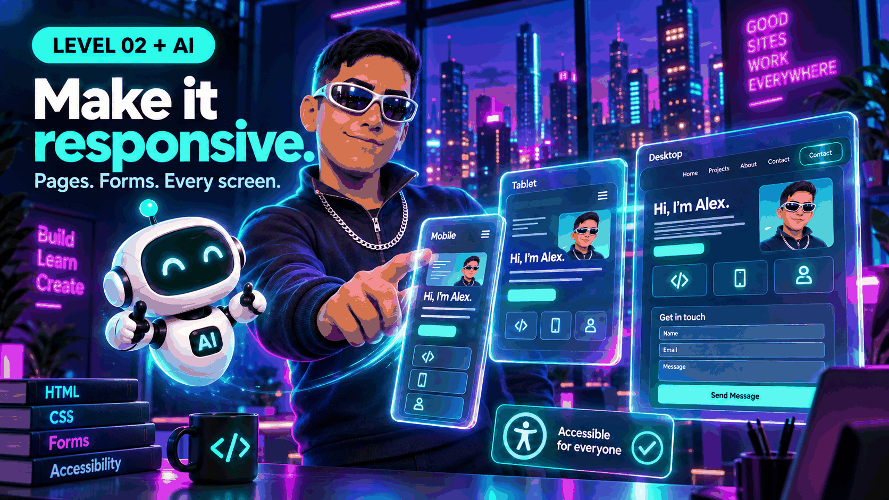

# Website development • Level 2 + AI

Turn one page into a small, responsive, accessible website. Use AI to explain and review, then test everything yourself.

New here? Start with [Level 1](https://github.com/yayacrypto/website-development-level-1).

## Who this is for

Learners who finished Level 1 and can edit HTML, CSS, and JavaScript files. No framework, account, paid AI subscription, or build tools are needed. This level is mostly HTML and CSS, with one small script.

## What you will build

A three-page portfolio site: Home, Projects, and Contact. It has shared navigation, a responsive card layout, and a contact form with browser validation. There is no backend: the form checks your input and shows a message, and nothing is sent or stored.

## Start here

1. Download this repository and extract it if needed.
2. Open the folder in a code editor.
3. Open `index.html` in a browser, then use the navigation to visit the other pages.
4. Edit a file, save it, and refresh.

```text
website-development-level-2/
├── README.md
├── LICENSE
├── index.html
├── projects.html
├── contact.html
├── styles.css
├── script.js
└── assets/
    └── hero.png
```

## What is new in Level 2

### 1. Semantic HTML

Pick elements for their meaning: `header`, `nav`, `main`, `section`, `article`, `footer`. Screen readers and search engines use them to understand the page.

```html
<nav aria-label="Main">
  <ul>
    <li><a href="index.html" aria-current="page">Home</a></li>
    <li><a href="projects.html">Projects</a></li>
  </ul>
</nav>
```

Try it: add a fourth page and link to it from every page. Mark the current page with `aria-current="page"`.

### 2. Responsive layout with Flexbox and Grid

Use Flexbox for one-dimensional rows, like the header and navigation. Use Grid for cards. Design for a narrow screen first, then add a media query when the layout needs more room.

```css
.cards {
  display: grid;
  gap: 1rem;
  grid-template-columns: repeat(auto-fit, minmax(min(100%, 15rem), 1fr));
}

@media (min-width: 48rem) {
  .hero { grid-template-columns: 1.3fr 1fr; }
}
```

Try it: resize the browser from narrow to wide. Find where the layout changes and explain why.

### 3. Forms that people can use

Every input needs a visible `label` connected with `for` and `id`. Use the right input `type`, mark required fields, and write error messages that say what to fix.

```html
<label for="email">Email
  <input id="email" name="email" type="email" autocomplete="email" required>
</label>
```

Try it: submit the empty form with the keyboard only. Where does focus go? Is the message clear?

### 4. Accessibility basics

- Add a skip link so keyboard users can jump past the navigation.
- Keep a visible focus outline. Do not remove it.
- Write alt text that explains the purpose of an image. Decorative images get empty alt text.
- Check color contrast. Do not use color alone to show meaning.
- Use one `h1` per page and keep headings in order.

## How to build with AI

AI can draft layouts, explain CSS, and review markup. It can also invent properties, ignore accessibility, or give you code that looks right but fails on a phone. Treat every answer as a suggestion to check.

### Step 1. Plan the pages first

**Prompt to try**

> I am building a three-page beginner portfolio with plain HTML and CSS. Suggest a page list and a heading outline for each page. Do not write code yet.

### Step 2. Ask for one layout at a time

**Prompt to try**

> Here is my HTML for a card list. Write only the CSS Grid rules to make it one column on phones and several columns on wide screens. Explain each rule and how to test it.

### Step 3. Ask AI to review accessibility, then verify

**Prompt to try**

> Review this HTML for accessibility problems: headings, labels, link text, alt text, and keyboard use. Separate certain problems from things I must test myself. Do not claim you ran a screen reader.

### Step 4. Debug with evidence

**Prompt to try**

> Expected: the cards stack on a 375px-wide screen. Actual: the page scrolls sideways. Here is the HTML and CSS. Help me find the cause and suggest the smallest fix.

### Step 5. Compare AI advice with documentation

Check anything you do not recognize on MDN before using it. If AI and the documentation disagree, trust the documentation and ask a follow-up.

## Safety habits

- Never paste private data, passwords, or API keys into an AI prompt or a public repository.
- A front-end form cannot protect data. Do not collect real personal data until you have a server and a privacy plan.
- Use photos, fonts, and text you have permission to publish.
- Do not add external scripts or trackers you do not understand.

## Test checklist

- [ ] All three pages load and the navigation works from each one.
- [ ] The layout works at about 360px, 768px, and 1200px wide, and at 200% zoom.
- [ ] No horizontal scrolling at narrow widths.
- [ ] You can complete the form with the keyboard only.
- [ ] Each field has a visible label and the error message names the problem.
- [ ] The skip link appears when you press Tab on a fresh page load.
- [ ] The browser console shows no errors.

## Small challenges

1. Replace the sample content with your own portfolio.
2. Add a dark color scheme with the `prefers-color-scheme` media query.
3. Add a table of opening hours or a schedule, with proper header cells.
4. Add an `aria-live` message to the form and explain when screen readers announce it.
5. Ask AI for two layout ideas, build one, and write down why you chose it.

## Before publishing

A public repository shares source files. It does not create a live website. Remove anything private first. Level 4 covers publishing.

## Ready for Level 3?

Move on when you can build a responsive page without copying, label a form correctly, and explain why a layout breaks on a small screen. Next topics: DOM manipulation, events, saving data in the browser, and fetching data.

## References

- [MDN: HTML elements reference](https://developer.mozilla.org/en-US/docs/Web/HTML/Reference/Elements)
- [MDN: CSS grid layout](https://developer.mozilla.org/en-US/docs/Web/CSS/CSS_grid_layout)
- [MDN: Responsive design](https://developer.mozilla.org/en-US/docs/Learn_web_development/Core/CSS_layout/Responsive_Design)
- [MDN: Web forms](https://developer.mozilla.org/en-US/docs/Learn_web_development/Extensions/Forms)
- [MDN: Accessibility](https://developer.mozilla.org/en-US/docs/Learn_web_development/Core/Accessibility)
